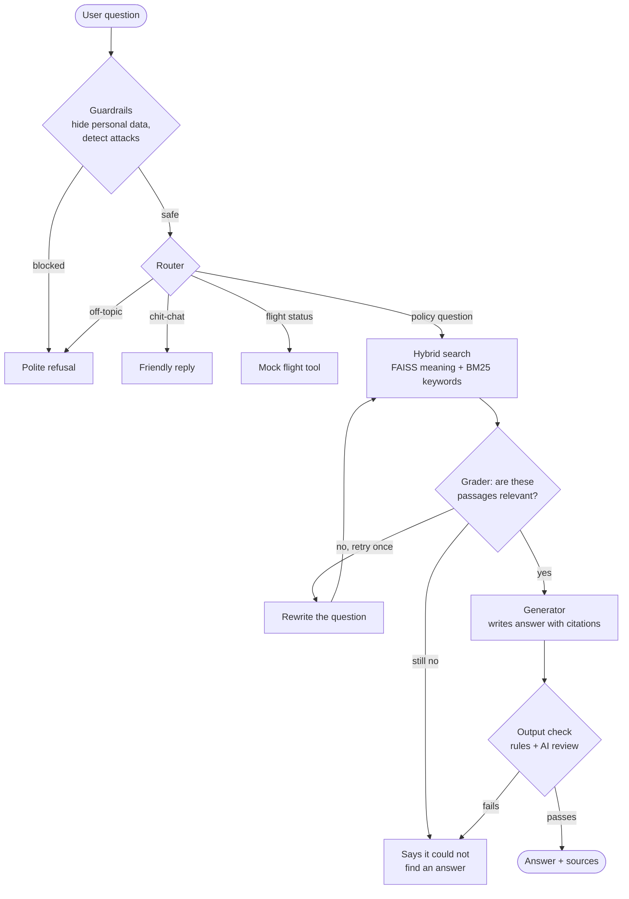

# ✈️ Emirates Policy Assistant

A chatbot that answers questions about Emirates travel policies (baggage, check-in, refunds, special assistance) and shows exactly which document each answer came from.

> **Unofficial demo.** Not affiliated with Emirates. Always verify important details on emirates.com.

Built as a final-year AI Engineering capstone project (2026).

---

## What it does

- **Answers policy questions** using 17 official Emirates PDF documents
- **Shows its sources:** every answer links to the original document, page and passage
- **Says "I don't know"** instead of guessing, and politely refuses off-topic, price or booking requests
- **Stays safe:** blocks attempts to trick it, and removes personal data (emails, card numbers, passports) before anything is processed or logged
- **Keeps working when an AI provider is down** by switching automatically from Gemini to Groq
- **Remembers the conversation**, so follow-ups like *"What about Business Class?"* work

## How it works

This is a **RAG** (Retrieval-Augmented Generation) system. In simple terms:

1. **Check the question:** block tricks, hide personal data
2. **Find** the most relevant passages in the documents (keyword + meaning search)
3. **Check** that the passages actually answer the question
4. **Write** an answer using only those passages, with citations
5. **Verify** the answer before showing it (for example, no invented prices)

### Architecture



**Provider failover:** every AI call goes through one gateway. It tries Gemini first and switches to Groq automatically if Gemini is down or rate-limited.

---

## Results

Tested on 41 questions (26 answerable, 15 refusal or attack questions). Run on 2026-10-27.

| What was measured | Result | In plain English |
|:--|:--|:--|
| Automated tests | **158 passed** | The code works as designed |
| Finding the right document | **100%** (26/26) | The correct source was always in the top 4 results |
| Finding all relevant sources | **90%** | Most relevant documents were retrieved |
| Live answers completed | **100%**, 0 errors | Every question got an answer |
| Correct answer-or-refuse decisions | **40 of 41** | Verified by manual review* |
| Match with reference answers (token F1) | 0.54 | Weak signal: only 6 reference answers exist |
| Full agent evaluation (LangGraph) | *Pending rerun* | Interrupted by a free-tier rate limit |
| Red-team (attack) suite | *Pending run* | 16 adversarial cases |

\*The automatic score was 88% (36/41). Reviewing the 5 flagged cases showed 4 were correct refusals the scorer failed to recognize because of different wording. One was a real mistake: a "no-show ticket" question was wrongly refused.

**Read these numbers carefully**
- Answers were generated by one provider (Groq `gpt-oss-120b`); Gemini was unavailable during testing.
- The test set is small, so one failure moves a score by about 4 points.
- A "hit" means the right document was retrieved, not that the answer was correct.
- A 10-question holdout set has not been run yet, so retrieval scores may be slightly optimistic.

---

## Quick start

```bash
git clone https://github.com/TannushreeVaishnav/emirates-rag
cd emirates-rag
python -m venv .venv
.\.venv\Scripts\Activate.ps1        # Windows (macOS/Linux: source .venv/bin/activate)
pip install -r requirements.txt

copy .env.example .env              # then add GOOGLE_API_KEY and GROQ_API_KEY
python -m src.ingest                # builds the search index (3-5 min, first run)
python -m streamlit run app.py      # opens the chat at localhost:8501
```

Requires Python 3.11+. Free API keys: [Google AI Studio](https://aistudio.google.com) and [Groq](https://console.groq.com).

## Testing and evaluation

```bash
python -m pytest tests/ -v                                   # 158 tests, no API calls
python -m eval.run_eval --retrieval-only --max-api-calls 0   # free retrieval check
python -m eval.run_eval --config baseline --no-judge         # live answer check
python -m eval.run_redteam                                   # attack tests
python -m streamlit run pages/1_Evaluation.py                # view saved reports
```

Live runs on free tiers can hit rate limits. Use `--sleep 20` and run one `--category` at a time. Every report shows sample sizes, and failed or unfinished cases are never counted as successes.

## Project structure

```
app.py              Chat interface (Streamlit)
src/                Core logic: retrieval, agent, guardrails, AI-provider failover
eval/               Evaluation scripts and question sets
pages/              Evaluation dashboard
tests/              158 automated tests
data/               Source list and mock flight data (PDFs not included)
```

## Tech stack

Python · LangChain · LangGraph · FAISS + BM25 · Streamlit · Gemini · Groq

## Limitations

- Documents were collected on one date and may be out of date
- Small evaluation set; only 6 questions have reference answers
- The AI judge is the same model family as the answer generator, which can inflate scores
- Free-tier rate limits can slow answers or interrupt long evaluation runs